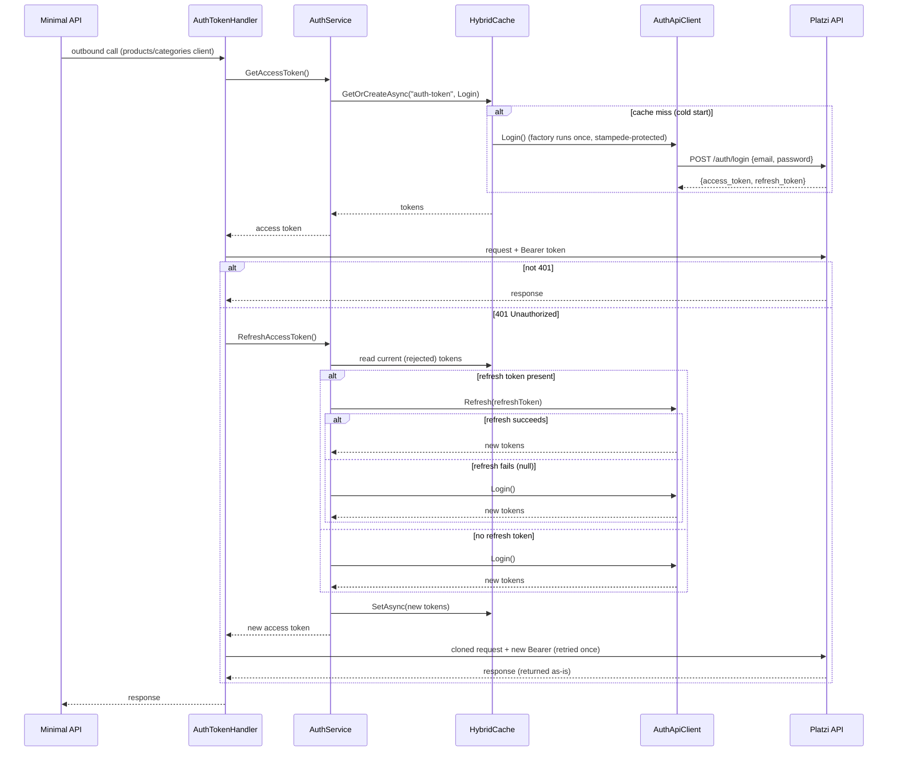

# CSharpApp

A .NET 9 Web API that sits in front of the [Platzi Fake Store API](https://api.escuelajs.co/api/v1)
(`https://api.escuelajs.co`), re-serving products and categories and authenticating to it with JWT.

The codebase is a layered (Clean/Onion) solution with CQRS, typed `HttpClient`s, Polly resilience,
and a lazy, cache-backed token flow.

---

## Architecture

Four projects, dependencies pointing inward (`Api → Infrastructure → Application → Core`):

| Project | Responsibility |
|---|---|
| **CSharpApp.Core** | The pure center: DTOs, service interfaces, settings POCOs, constants. No dependencies. |
| **CSharpApp.Application** | Business logic: the HTTP-calling services, the MediatR queries/commands, and the auth token engine. |
| **CSharpApp.Infrastructure** | Composition root: DI extension methods that wire up options, the typed clients, Polly, HybridCache and MediatR. |
| **CSharpApp.Api** | The host: minimal-API endpoints, Serilog, API versioning, OpenAPI. |

Why this shape: `Core` has no framework dependencies, so the domain and contracts stay portable;
`Application` depends only on `Core`; `Infrastructure` is the only place that knows about DI, HTTP and caching.
The `Api` host stays thin — it maps routes to MediatR messages and nothing else.

---

## HTTP clients & resilience

The original code created `new HttpClient()` inside a singleton service and mutated its `BaseAddress`
per call — the classic socket-exhaustion / stale-DNS anti-pattern. That was replaced with **typed clients**
registered through `IHttpClientFactory`:

```csharp
services.AddHttpClient<IProductsService, ProductsService>()
        .SetHandlerLifetime(handlerLifetime)          // from HttpClientSettings.LifeTime
        .AddPolicyHandler(GetRetryPolicy(settings))    // Polly, outer
        .AddHttpMessageHandler<AuthTokenHandler>();     // auth, inner
```

Choices made:

- **Typed clients** so each service gets a factory-managed `HttpClient` with a rotated handler, and its
  `BaseAddress` is set once in the constructor.
- **Polly** (`HandleTransientHttpError().WaitAndRetryAsync(...)`) for **transient transport faults only**
  (5xx / 408 / network), configured from `HttpClientSettings` (`RetryCount`, `SleepDuration`). A `401` is
  deliberately *not* retried by Polly — that is an auth concern, handled separately (see below).
- **Handler ordering:** Polly is registered **outer**, `AuthTokenHandler` **inner**, so the token is
  (re)attached on each attempt and transient retries wrap the whole call.
- All HTTP-client and Polly wiring lives in `Infrastructure/Configuration/HttpConfiguration.cs`; the
  service/options/cache/MediatR registrations live in `DefaultConfiguration.cs`.

---

## API endpoints

Minimal APIs with **API versioning** (`api/v{version}/...`), each one a thin dispatch to a **MediatR**
message (CQRS). Endpoints carry no logic beyond mapping the result to an HTTP status.

| Method & route | Message | Result |
|---|---|---|
| `GET  /api/v1/getproducts` | `GetProductsQuery` | `200` list |
| `GET  /api/v1/products/{id}` | `GetProductByIdQuery` | `200` / `404` |
| `POST /api/v1/products` | `CreateProductCommand` | `201` / `400` |
| `GET  /api/v1/getcategories` | `GetCategoriesQuery` | `200` list |
| `GET  /api/v1/categories/{id}` | `GetCategoryByIdQuery` | `200` / `404` |
| `POST /api/v1/categories` | `CreateCategoryCommand` | `201` / `400` |

Choices made:

- **CQRS via MediatR:** queries and commands are separate records with dedicated handlers, keeping the
  host trivial and the logic unit-testable. Handlers are `internal` (exposed to tests via `InternalsVisibleTo`).
- **Correct REST semantics:** a missing resource returns `404` (not `200` with a null body); a create
  returns `201 Created` and a rejected create returns `400`.
- **Auth is not an endpoint.** Authentication to the third party is cross-cutting plumbing (a delegating
  handler), not something the caller of this API sees or triggers.

---

## Authentication

The third party API is JWT-protected: you `POST /auth/login` with credentials and get back an
`access_token` + `refresh_token`; protected calls then carry `Authorization: Bearer <access_token>`;
an expired access token can be swapped for a fresh one via `POST /auth/refresh-token`.

Our job is **outbound** auth: obtain a token, attach it to downstream calls, and keep it usable — without
leaking token logic into every service. Three pieces do this:

| Component | Role |
|---|---|
| `AuthApiClient` (`IAuthApiClient`) | **Pure transport.** `Login()` and `Refresh()` against Platzi. No token attached (logging in must not require a token). |
| `AuthService` (`IAuthService`) | **The engine.** Caches the token, decides login vs. refresh, exposes `GetAccessToken()` and `RefreshAccessToken()`. |
| `AuthTokenHandler` (`DelegatingHandler`) | **The glue.** Attaches the Bearer token to outbound requests and reacts to `401`. |

### The flow



### Every branch, and why

**1. Getting a token — `GetAccessToken` → `HybridCache.GetOrCreateAsync("auth-token", Login)`**

- **Cache miss (cold start):** the factory runs `AuthApiClient.Login()` once, and the resulting
  `{ access, refresh }` bundle is cached. Under concurrency, HybridCache's stampede protection guarantees
  a **single** login while the other callers await it.
- **Cache hit:** the cached bundle is returned; no network call. This is the normal, hot path.

**2. Sending — `AuthTokenHandler`**

- Attaches `Authorization: Bearer <access token>` and sends.
- **Not a 401** → return the response untouched.
- **401 Unauthorized** → the token was rejected; dispose the response and refresh (below). Note we branch
  on `401` specifically, **not** `403`: a 401 means "who are you / your credential is stale" (a new token can
  help), whereas a 403 means "you're known but not allowed" (a new token cannot help, so we don't retry).

**3. Refreshing — `RefreshAccessToken`**

- Reads the current (just-rejected) bundle from the cache to get the refresh token.
- **Refresh token present and `Refresh()` succeeds** → new tokens; logged as *"Access token refreshed."*
- **Refresh token present but `Refresh()` fails (returns `null`)** → fall back to a full `Login()`.
- **No refresh token** → go straight to `Login()`.
- Whatever path produced the new bundle is written back with `SetAsync`, and the new access token is returned.

  Why prefer refresh over login: refresh is the cheaper, credential-free way to extend a session (in a real
  OAuth provider you often don't even *hold* the password, so refresh is the only option). A full login is
  the fallback for when refresh can't be done.

**4. Retrying — back in the handler**

- The original `HttpRequestMessage` can't be resent (it's single-use and its body stream is spent), so it's
  **cloned** (buffering the body) and the **new** token is stamped onto the clone.
- The clone is sent **once**. If it *also* returns `401`, that response is returned as-is — **no loop**.

### Why it's lazy (reactive, not proactive)

There is **no JWT `exp` parsing and no pre-send freshness check.** We attach whatever token is cached and
only refresh **reactively** — when Platzi actually answers `401`. A token is therefore used right up until it
is rejected ("lazy refresh on 401").

- **Cost:** the first request after a token truly expires eats one wasted `401` round-trip before the retry
  succeeds. For this API's long-lived tokens that is vanishingly rare.
- **Benefit:** no JWT decoding, no dual proactive/reactive machinery to keep in sync, and a much smaller
  cached value.
- **Bonus:** the reactive path also handles things a proactive `exp` check *couldn't* predict — server-side
  revocation, key rotation, clock skew — because it trusts the server's `401`, not a local clock.

### Why HybridCache

The token must be shared across requests, and the interesting problem is concurrency on a cache miss.

- **Stampede protection is built in.** On a miss, `GetOrCreateAsync` runs the factory **once per key** and
  makes concurrent callers await that single result — so ten simultaneous first-requests produce **one**
  login, not ten. This is exactly what a manual `SemaphoreSlim` + double-checked lock would give, but
  declarative and without the hand-rolled synchronization.
- Plain `IMemoryCache` would **not** remove that lock — it has no stampede protection — so it is specifically
  HybridCache that lets us delete the semaphore.
- It also owns entry lifetime via `CachingConfiguration.AuthTokenCacheLifetime` (a coarse ceiling that keeps
  the bundle — and thus the refresh token — around; actual token rejection is handled by the 401 path, so the
  exact TTL is not safety-critical).

The whole token bundle (`AuthTokens`) is cached under the key `CacheName.AuthToken`, so the refresh token
survives alongside the access token and the refresh branch can use it.

> Note: the `AuthApiClient` (login/refresh) is intentionally **not** wired with `AuthTokenHandler` —
> otherwise acquiring a token would itself require a token. Only the products/categories clients carry the handler.

---

## Configuration

`src/CSharpApp.Api/appsettings.json`:

- **`RestApiSettings`** — `BaseUrl`, relative paths (`Products`, `Categories`, `Auth`, `RefreshToken`), and the
  downstream credentials (`Username`, `Password`). Relative paths are stored *without* a leading slash so they
  resolve against the `/api/v1/` base.
- **`HttpClientSettings`** — `LifeTime` (handler lifetime, minutes), `RetryCount`, `SleepDuration` (Polly).
- **`CachingConfiguration`** — `AuthTokenCacheLifetime` (the token-cache ceiling).

---

## Running

Local:

```bash
dotnet run --project src/CSharpApp.Api
```

Requests to try live in `src/CSharpApp.Api/CSharpApp.Api.http`. OpenAPI is served in Development.

Docker (VS-generated multi-stage build, context = `src/`):

```bash
docker compose -f src/docker-compose.yml up --build
```

---

## Testing

```bash
dotnet test src/CSharpApp.sln
```

The suites cover the token engine (login-once / refresh / fallback against a real in-memory HybridCache),
the `AuthTokenHandler` (attach, 401→refresh→retry-once, body replay), the typed services (parsing and
error handling), the MediatR handlers, the DTO wire contracts, and the DI composition root.
